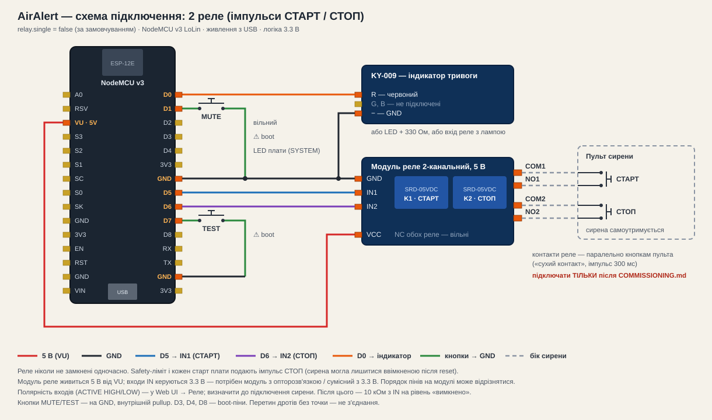
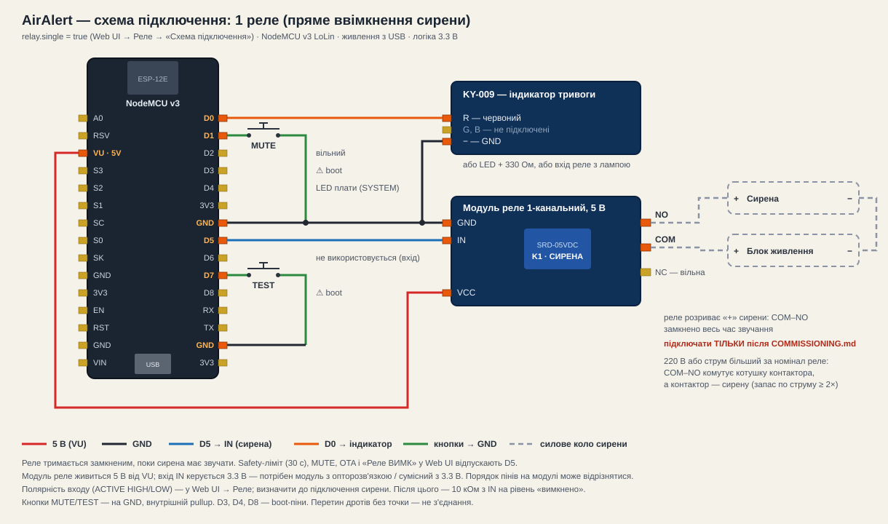

# Апаратна частина

## Плата

NodeMCU v3 LoLin — ESP8266EX, 4 МБ флеш, CH340, кварц 26 МГц, живлення 5 В
через USB або VIN (внутрішній стабілізатор 3.3 В). Логіка **тільки 3.3 В**.

## Схеми підключення

Та сама прошивка, схема обирається параметром `relay.single`.

**2 реле** (за замовчуванням) — імпульси СТАРТ/СТОП на кнопки пульта сирени:

**1 реле** — реле вмикає сирену напряму (або через контактор):

## Розводка пінів

| Пін | GPIO | Призначення | Чому саме він |
|---|---|---|---|
| D5 | GPIO14 | Реле 1 — кнопка СТАРТ сирени (імпульс) | не boot-strap пін (SPEC 64) |
| D6 | GPIO12 | Реле 2 — кнопка СТОП сирени (імпульс) | не boot-strap пін |
| D1 | GPIO5 | Кнопка MUTE (на GND, pullup) | перенесено з D6 під реле СТОП |
| D7 | GPIO13 | Кнопка TEST (на GND, pullup) | вільний, з перериваннями |
| D2 | GPIO4 | вільний | |
| D4 | GPIO2 | Вбудований LED (інверсний) | SYSTEM-індикатор |
| D0 | GPIO16 | Вихід «тривога»: LED або реле-індикація | без PWM/переривань — для простого виходу цього досить |

**Не використовувати:** D3/GPIO0, D4/GPIO2 (крім вбудованого LED), D8/GPIO15 —
boot-strap; D9/D10 — USB-UART; D0/GPIO16 — без PWM/переривань.

## Реле

Двоканальний модуль реле. Контакти (COM/NO) кожного реле паралельно кнопкам
пульта сирени: реле 1 (D5) — «СТАРТ», реле 2 (D6) — «СТОП». Сирена
самоутримується, тому прошивка не тримає реле, а «натискає» кнопку імпульсом
300 мс (`RelayController::kPulseMs`). Обидва реле ніколи не замкнені
одночасно. Safety-ліміт безперервної роботи спрацьовує імпульсом СТОП; при
кожному старті плати також подається один імпульс СТОП (сирена могла
лишитися ввімкненою після reset).

**Варіант з одним реле** (`relay.single = true`, Web UI → Реле → «Схема
підключення»): реле на D5 вмикає сирену напряму або через контактор і
тримається замкненим весь час звучання; D6 не використовується (пін
переводиться у вхід). Safety-ліміт, MUTE, OTA і «Реле ВИМК» відпускають D5.
Та сама прошивка: схема обирається в налаштуваннях, за замовчуванням — 2 реле.

- Модуль реле з опторозв'язкою, сумісний з 3.3 В логікою, АБО транзисторний
  драйвер (NPN + діод на котушці). Котушку НЕ живити з GPIO.
- Полярність (ACTIVE_HIGH/ACTIVE_LOW) невідома до commissioning — див.
  COMMISSIONING.md. До визначення полярності сирену фізично не підключати.
- Після визначення полярності — зовнішній резистор (10 кОм) з керуючого піна
  на рівень "вимкнено", щоб реле мовчало при reset/прошивці (SPEC 65).

## Індикація: спрощена схема (основна, рішення власника 21.08.2026)

- **Вбудований LED (D4)** — стан системи: горить постійно = все робоче
  (Wi-Fi + час + токен + свіжі дані API); повільно блимає = проблема;
  швидко блимає = режим налаштування/OTA.
- **D0 (GPIO16)** — «тривога»: простий LED (резистор 330 Ом на GND) або
  **вхід реле-модуля з лампою**. Горить, поки активна будь-яка тривога.
  Для реле у Web UI увімкніть «Стійкий сигнал» (без блимань — реле не
  клацає) і виберіть полярність модуля (більшість китайських — ACTIVE LOW).
  Це індикаційне реле, НЕ сирена: воно світить лампою годинами — safety-ліміт
  сирени на нього свідомо не поширюється.
- D2 вільний; D1 тепер зайнятий кнопкою MUTE — майбутньому RGB-бекенду
  (I2C) знадобиться інша пара пінів або WS2812 на D2.

## Повна версія: RGB LED через MCP23017 (SPEC 60-63, збережена як опція)

- MCP23017 на I2C (адреса 0x20, A0-A2 на GND)
- SYSTEM RGB: GPA0/1/2, ALERT RGB: GPA3/4/5
- Кожен канал — свій струмообмежувальний резистор (220-470 Ом від характеристик LED)
- Тип LED (спільний анод/катод) — у конфігурації, драйвер інвертує сам
- **Статус:** драйвер MCP23017 буде додано, коли з'явиться фізичний чіп;
  зараз індикація на вбудованому LED (див. src/hardware/StatusLed.h)

## Сирена

Якщо сирена мережева (220 В): силова частина фізично ізольована від плати,
монтаж — за правилами електробезпеки, запас реле по струму ≥ 2×. (SPEC 66)
